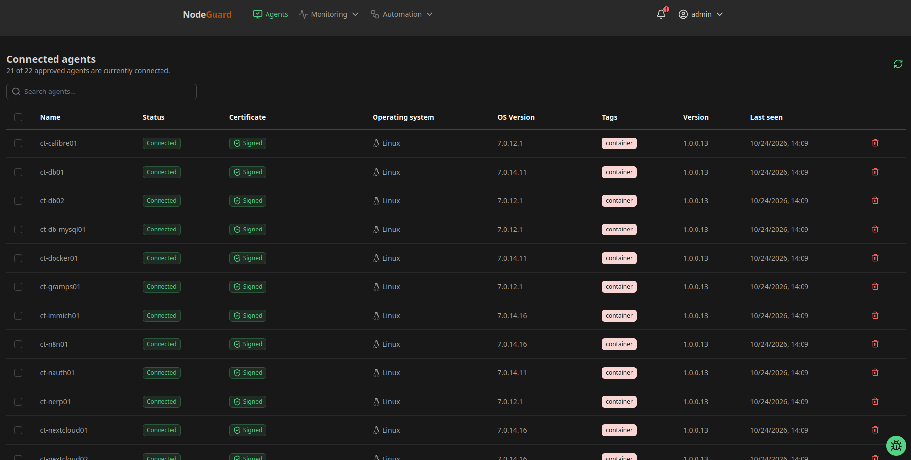
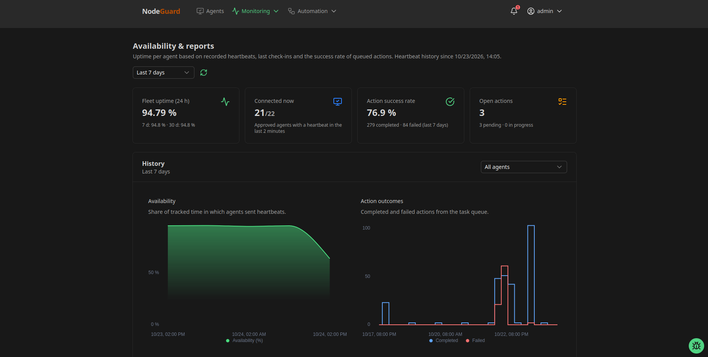
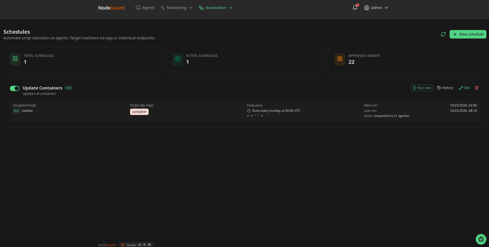

# NodeGuard
A Lightweight Selfhosted UEM for local networks

Verwalte die Server in deinem Heimnetz zentral über eine Web-App: Status und Hardware im Blick, Skripte ausführen und planen, Logs und Dateien einsehen, Agents aktualisieren.

## Einblicke

**Agents im Überblick:** Status, Zertifikat, Betriebssystem, Tags und Agent-Version aller Server auf einen Blick.

**Verfügbarkeit & Berichte:** Uptime aus den Heartbeats und Erfolgsquote der ausgeführten Aktionen.

**Zeitpläne:** Skripte per Cron automatisch auf Servern ausführen, ausgewählt über Tags oder einzeln.

## Loslegen

- **[Quick Start](quick-start.md)** – Server per Docker Compose starten und den ersten Agent einbinden
- [`docker/docker-compose.yml`](docker/docker-compose.yml) und [`docker/.env.example`](docker/.env.example) – Beispiel-Setup
