# NodeGuard Features

NodeGuard is a self-hosted web app for managing the servers in your home network from one place. This page describes every feature of the web app, the agent and the CDN.

## Contents

1. [Sign-in and setup](#1-sign-in-and-setup)
2. [Dashboard](#2-dashboard)
3. [Agents](#3-agents)
4. [Agent details](#4-agent-details)
5. [Automation](#5-automation)
6. [Alerts and notifications](#6-alerts-and-notifications)
7. [Agent updates](#7-agent-updates)
8. [Availability and reports](#8-availability-and-reports)
9. [Audit log](#9-audit-log)
10. [Settings](#10-settings)
11. [Bug reports and telemetry](#11-bug-reports-and-telemetry)
12. [Agent](#12-agent)
13. [CDN](#13-cdn)

## 1. Sign-in and setup

- **Login page:** the web app requires a sign-in. Sessions are valid for 7 days.
- **Initial setup:** on the first start, create the administrator with your own password, or sign in with an OpenID Connect provider. See [Sign-in with OIDC](oidc.en.md).
- **Single sign-on (OIDC):** works with Authentik, Keycloak, Authelia, Zitadel and other providers. Password login stays available next to it. Identities are linked to accounts by issuer and subject.
- **Change password:** under **Settings → Account**. The current password is required. All other sessions are signed out afterwards.
- **Password reset:** if the password is lost, run `docker compose exec nodeguard reset-password` on the Docker host. Then run the initial setup again. Agents and other data are kept.
- **Plain HTTP:** works on the home network without a certificate.

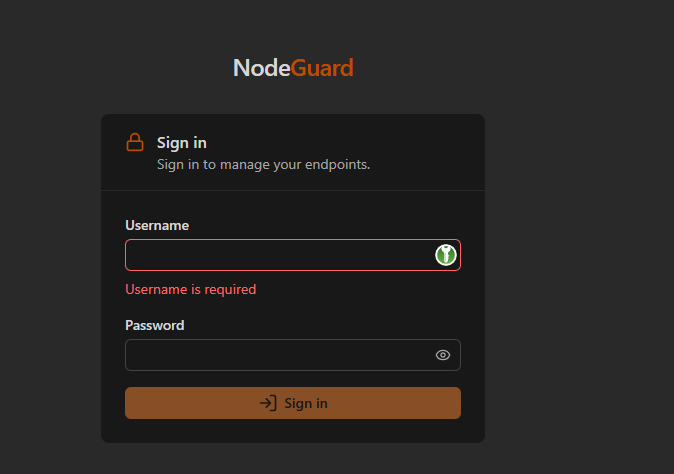

## 2. Dashboard

The dashboard gives an overview of the whole fleet:

- connected agents and pending approvals
- distribution by operating system
- recent activity
- upcoming schedules

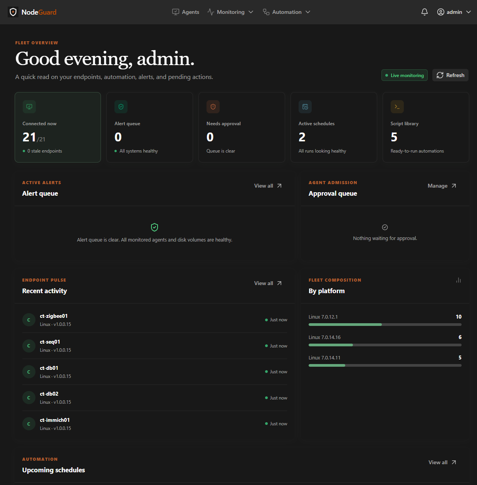

## 3. Agents

### Agent list

- Search agents by name.
- Filter by tags, operating system, agent version and status.
- See online status. An agent is online if it sent a heartbeat within the last 120 seconds.
- Stale agents are detected when they have had no contact for 7 days.
- Delete single agents (including their data) or clean up all stale agents.
- The certificate status of each agent is shown in the list.

### Tags

- Colored tags can be assigned to agents.
- Tag names must be unique and have a length limit.
- Tags are used to target scripts and schedules at several agents at once.
- Deleting a tag also removes it from schedules. Schedules without a remaining target are disabled.

### Onboarding agents

- **Invites:** create an invite with a label, an expiry time and single or multiple use.
- **Install command:** a one-line command (`curl …/api/agents/install.sh | bash`) is generated. The download is verified with SHA-256, and the server CA fingerprint is included.
- **Approval queue:** new agents must be approved before they are managed.
- **Certificates:** each agent has its own key pair and client certificate. See the certificate tab below.

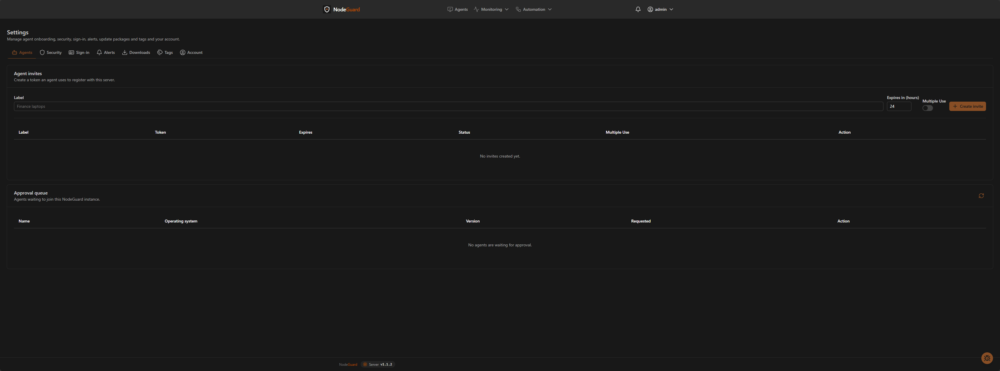

## 4. Agent details

Each agent has its own page with these sections:

- **Information:** operating system, version, architecture, hostname, IP addresses, timestamps and tags.
- **Hardware:** CPU, memory and drive usage as charts, including a condensed history.
- **Script execution:** run a script ad hoc on this agent and view output and exit code.
- **Actions:** a paginated task queue (20 per page, *Load more*) with status and input and result previews. Details of a task open in a dialog.
- **Users:** local users and their groups. Users removed on the endpoint are removed together with their groups.
- **Logs:** browse, search and read log files, including compressed `.gz` files.
- **File manager:** browse directories, download, upload, edit and delete files.
- **Processes and services:** view and manage processes and services on the agent. *(Details to be confirmed by the maintainer.)*
- **Certificate:** shows status, validity and fingerprint. You can renew, revoke or re-issue the certificate with a one-time enrollment code.

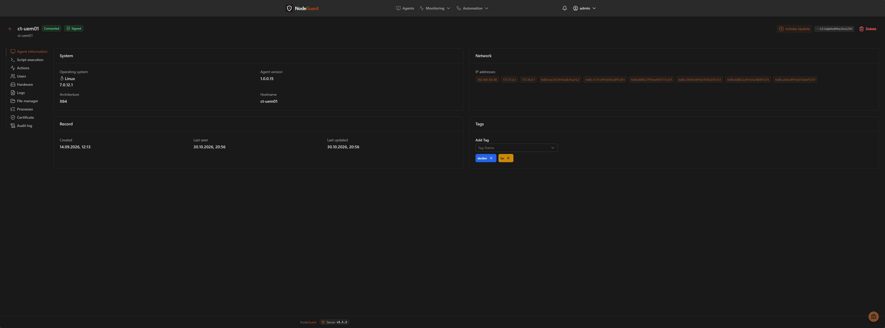

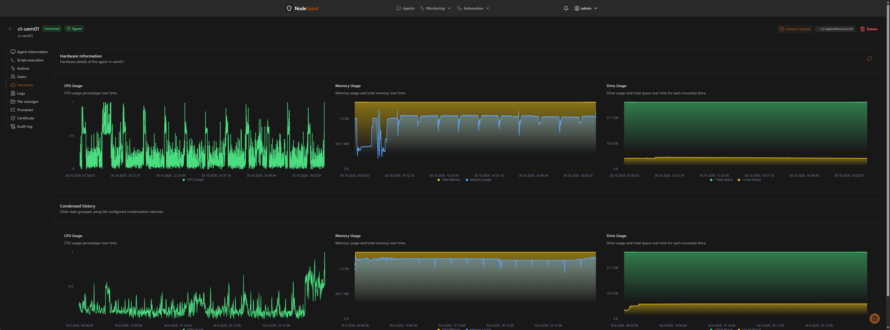

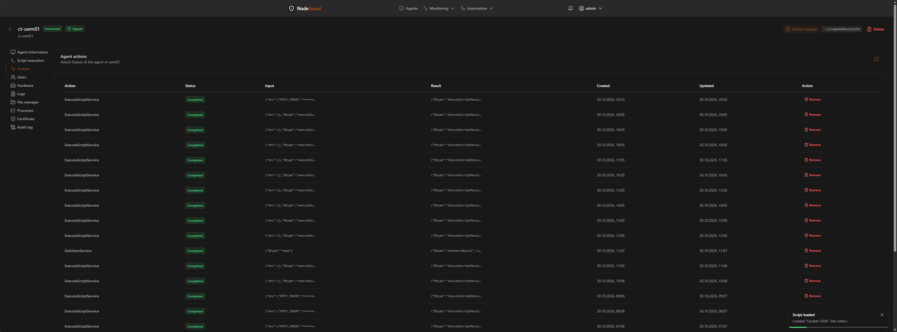

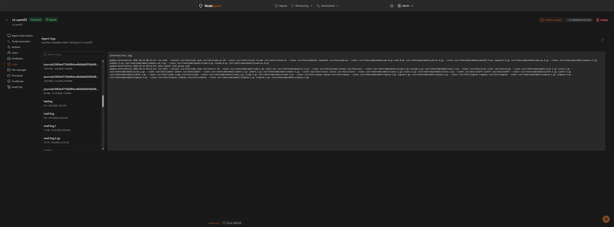

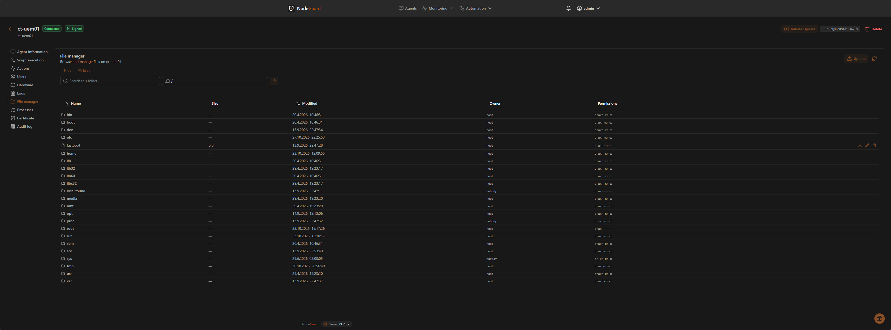

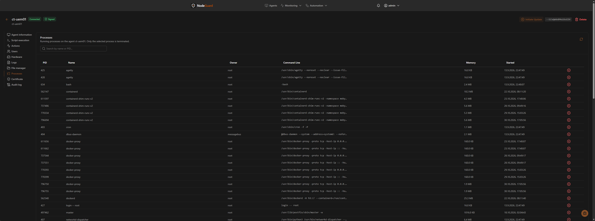

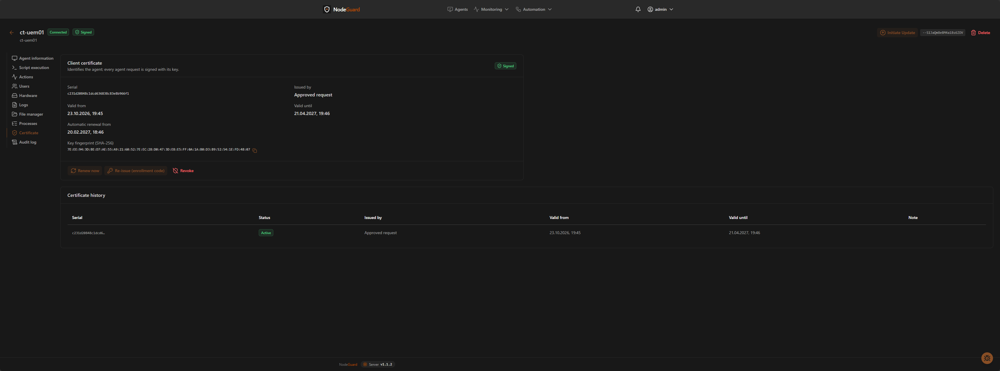

## 5. Automation

### Script library

- Store PowerShell or Bash scripts, with an optional working directory.
- Assign a script to agents or tags.
- The execution overview shows the results (status, output, exit code) of all targeted agents on one page.

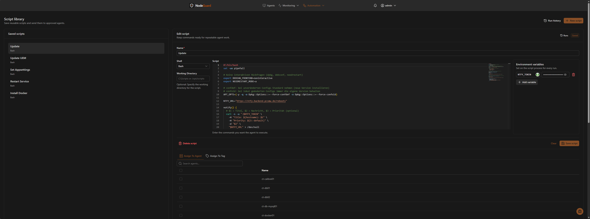

### Schedules

- Cron-based schedules that target agents or tags.
- Enable or disable a schedule, run it manually, and see the last and next run and its status.

### Script runs

- Every script assignment and every schedule run (scheduled or manual) is stored as a run, with time, trigger, user, script and schedule.
- The *Script runs* page lists runs newest first. Filter by script or schedule.
- A run shows status, output and exit code per agent.
- Results of deleted agents stay visible.

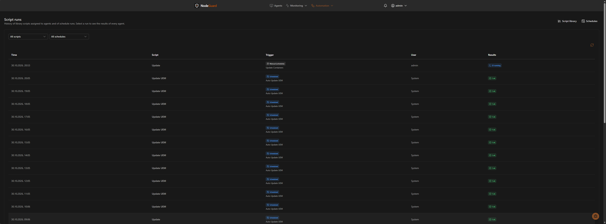

### Script limits

- A script runs for at most 60 minutes by default. After that, the agent terminates it together with all started processes and reports it as failed (exit code `-1`).
- At most 1 MB of output per stream (stdout, stderr) is stored. The rest is discarded and marked as truncated.
- Limits are set on the agent. See [Agent](#12-agent).

## 6. Alerts and notifications

### Alert rules

Rules are configured under **Settings → Alerts**. Guide (German): [alerts.md](alerts.md).

- **Rule types:** agent disconnected (minutes without heartbeat), disk usage per drive, CPU and memory usage (averaged over 1 to 60 minutes), new agent version available.
- Each rule has a warning and a critical threshold.
- Rules can be limited to tags. Several rules of the same type are possible.
- Default rules: disconnected after 2 minutes (critical), disk at 90 % (warning) and 95 % (critical), new agent version (info). CPU and memory rules are created disabled.

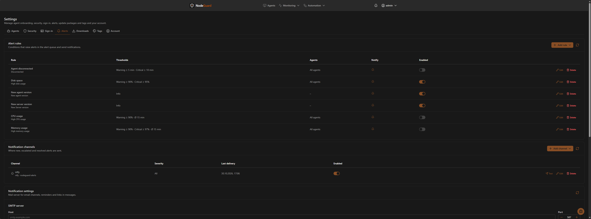

### Notification channels

Configured under **Settings → Notifications**.

- **E-mail (SMTP)** and **webhook** channels.
- Webhooks can send NodeGuard JSON with an optional HMAC signature, or formats for Slack, Mattermost, Discord and ntfy.
- Each channel has a minimum severity and a test button.
- A background job checks the rules every 60 seconds and sends messages for new, escalated and resolved alerts. Reminders are optional.

## 7. Agent updates

- Upload update packages (from version, to version, checksum).
- Packages are synchronized from the CDN every 5 minutes.
- Trigger an update to the next available version or to a specific version.
- Versions are sorted numerically, so `1.0.10.0` comes after `1.0.9.0`.

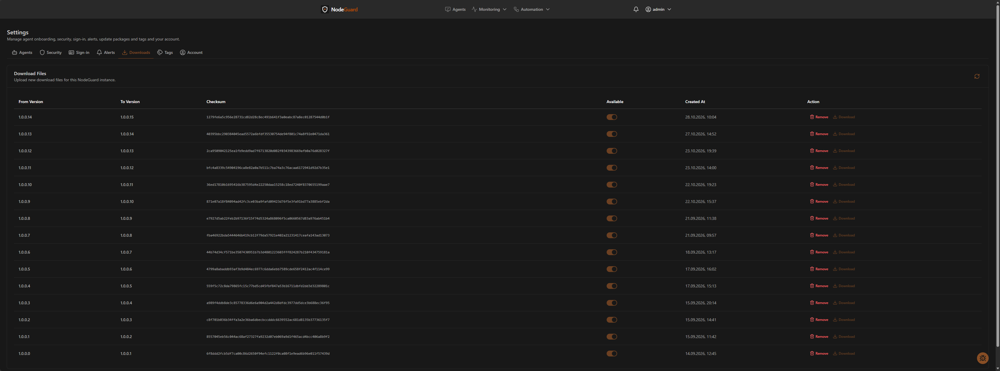

## 8. Availability and reports

- **Availability:** uptime per agent for the last 24 hours, 7 days and 30 days, last check-in and the success rate of queued actions. Charts show availability and action outcomes.
- **Reports:** inventory, health and availability, and activity (audit log, filterable by period and category). Export as CSV or JSON.

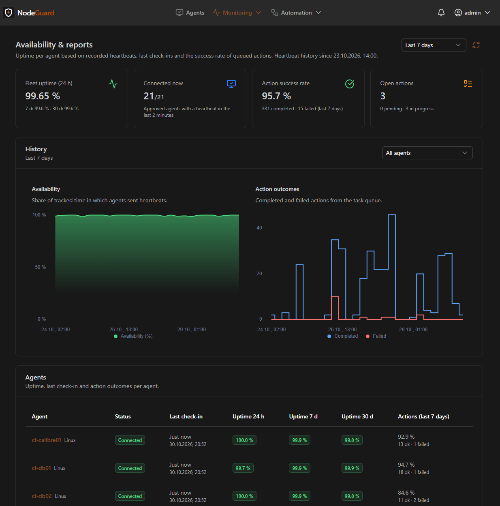

## 9. Audit log

Records who did what and when:

- sign-ins, including failed attempts, and sign-outs
- agent approvals and deletions, tags, invites
- script changes and runs, queued and removed agent actions
- schedule changes and agent update packages
- certificate issuing, renewal, revocation and rejected signatures

Each entry stores user, IP address, target and details. Secrets are redacted and long values are truncated. Filter by category and outcome. Entries are kept for `AUDIT_LOG_RETENTION_DAYS` days (default 365, `0` keeps them forever).

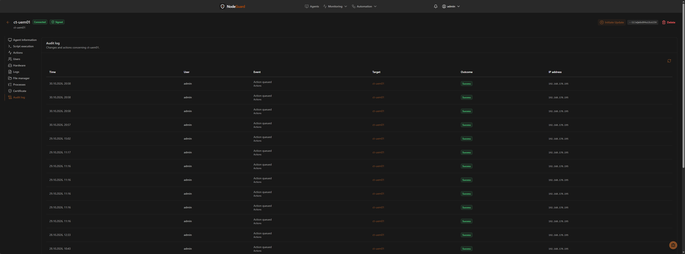

## 10. Settings

- **Account:** change password.
- **Sign-in:** configure single sign-on, link identities, allowed groups, automatic account creation.
- **Agent identity:** server CA fingerprint, certificate validity, allow unsigned legacy agents, enrollment requests.
- **Downloads:** agent packages and CDN synchronization.
- **Tags:** create and edit tags and their colors.
- **Alerts:** alert rules. See [section 6](#6-alerts-and-notifications).
- **Notifications:** notification channels.

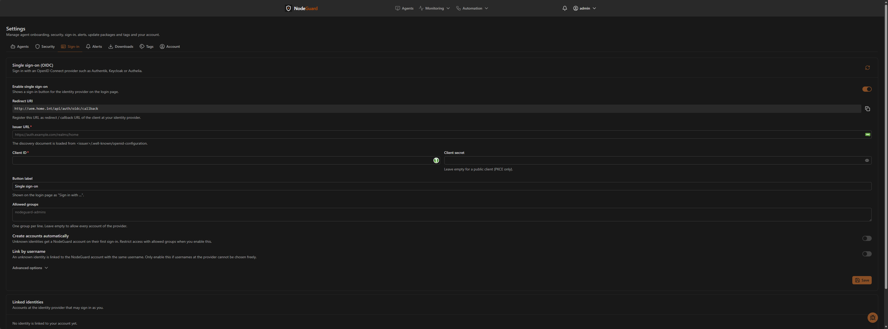

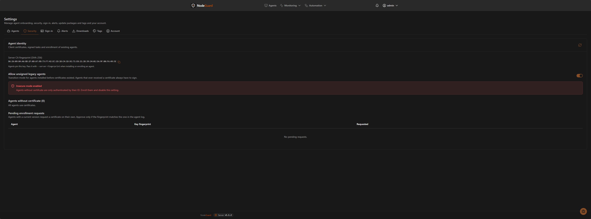

## 11. Bug reports and telemetry

- **Bug report button:** a floating button on every page opens a form with title, optional name and description. The form includes the current page and the last 5 visited pages. Reports are only sent when you submit them.
- **Telemetry:** with `TELEMETRY_ENABLED=true`, the server reports slow database queries (over 1 second) and server errors (HTTP 5xx) to the CDN, together with its instance ID and server version. It is off unless enabled. The shipped Docker Compose files enable it.

## 12. Agent

The agent runs on each endpoint as a service.

- **Installation:** registration with server URL and invite code. Installed as a systemd service on Linux. Unattended mode with `--yes`.
- **Identity:** own key pair and client certificate. Signed requests only. Certificates renew automatically with key rotation.
- **Health:** heartbeat every 60 seconds, and a system report on startup.
- **Statistics:** CPU, memory and drives every 15 seconds, sent in batches.
- **Tasks:** polled every 5 seconds. Results are stored on disk and retried every 30 seconds, so they survive restarts and server downtime.
- **Supported actions:** execute scripts (PowerShell, Bash), list users and groups, list and read logs, list directories, read, write and delete files, send report, self-update.
- **Self-update:** checksum verification, in-place file replacement that keeps `agentOptions.json`, and automatic service restart.
- **Update rollback:** the replaced files are backed up before an update. If an update fails, the backup is restored. If the new version does not send a heartbeat within `Update:HealthCheckTimeoutSeconds` (default 300 seconds), the previous version is restored. Rollbacks are written to the audit log. Turn off with `Update:RollbackEnabled=false`.
- **Structured errors:** failed actions report code, category, message, stack trace and the affected action.
- **Watchdog:** each worker reports a heartbeat. If a worker stalls, the service restarts. Configurable with `Watchdog:*` settings in `appsettings.json`.
- **Script limits:** `Scripts:TimeoutMinutes` (default 60) and `Scripts:MaxOutputKilobytes` (default 1024).
- **Package:** shipped as a self-contained single file for `linux-x64`. No .NET runtime is required on the endpoint.

## Not supported yet

- Windows agents (planned, see the roadmap)
- Software and package inventory
- Automatic detection of missing security updates
- Remote terminal and remote desktop
- Policies and compliance
